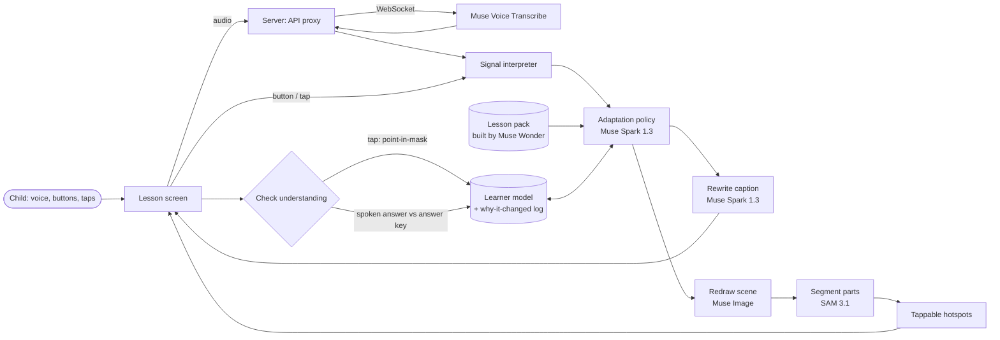

**Redraw**

# Architecture

**Redraw** is a visual learning sandbox for kids who learn differently. When a child says "I don't get it" or "this is boring", the lesson changes: the picture is redrawn in a world the child loves, the wording gets simpler or harder, and the child can tap parts of the picture to explore and be checked. Every change is logged with a reason.

Built for the Meta Global AI Developer Hackathon (Oct 27 – Nov 4, 2026). Everything in this repository was written during the hackathon; see `HACKATHON.md` for the daily build log.

## Setup and run

Prerequisites: Python 3.10+ (developed on 3.12), [uv](https://docs.astral.sh/uv/), and API keys (below).

```sh
uv sync                                # creates .venv from uv.lock
set -a; source .env; set +a            # load keys into the environment
.venv/bin/python src/app/server.py      # serves http://127.0.0.1:8000/
```

Open the lesson at <http://127.0.0.1:8000/> and parent setup at <http://127.0.0.1:8000/setup>. Pass `--port` to change the port.

Keys live in `.env` (gitignored, never committed):

| Variable | Used for | Required? |
| --- | --- | --- |
| `MODEL_API_KEY` | Policy, captions, say-it grading, voice transcription | Only for live calls; without it the lesson runs offline on the cached golden set with rule fallbacks |
| `BASETEN_API_KEY` | Private-mode open-weights backend | Only for Private mode |
| `REDRAW_BACKEND` | `meta` (default) or `baseten` | No |

Checks (from the repo root):

```sh
.venv/bin/python src/app/test_policy.py
.venv/bin/python src/app/run_replay.py --fallback-only  # offline; drop the flag for live (credit-spending) turns
.venv/bin/python src/app/check_contracts.py
.venv/bin/python src/app/test_voice.py
.venv/bin/python src/app/test_grading.py
node --check src/app/static/app.js
```

macOS note: the system Python ships no TLS trust roots; `certifi` is a declared prerequisite so `uv sync` fixes HTTPS with no extra setup.

## Design principles

- **The child steers.** The only inputs are what the child says, which button they press, and where they tap. There is no camera or voice-tone emotion detection. This complies with EU AI Act - running from Romania
- **Scene first, not chat.** The screen is a picture with a short caption. Text is secondary.
- **Deterministic where possible.** Tap answers are graded by geometry (point-in-mask), not by an LLM.
- **Auditable.** Every adaptation is a typed decision with a visible reason.
- **Private by default.** No child account, local storage only, Standard-mode (no-training) model IDs, and an optional mode running on open weights.

## System overview



## Components

| Component | Responsibility | Model / tech |
| --- | --- | --- |
| **Lesson screen** (`/`) | Shows the scene (tap anywhere to answer the prompt pill), caption with "Read to me" (browser speech synthesis), step progress, world pills, Calm mode, three signal buttons ("I don't get it", "Boring!", "Show me") and a hold-to-talk "Say it" button (a signal phrase steers; anything else is graded as the say-it answer). A jury strip toggles between **Jury view** (dashed SAM tap target and the "Why it changed" panel) and **Child view** (picture, caption, buttons only). The lock icon opens a two-question grown-ups gate that links to parent setup. | Web front end (`src/app/static/`) |
| **Parent setup** (`/setup`) | Age, sentence length, new words per step, favourite worlds (up to three), calm toggles (calm colours, no timers, large text, read aloud, reduce motion), Standard vs Private mode. Saved in browser `localStorage` (`redraw.settings`); only the mode is sent to the server. | Web front end |
| **API proxy** | Holds the API key, relays requests, proxies the transcription WebSocket. The key is never sent to the browser. | FastAPI on Modal (free tier), OpenAI SDK pointed at `https://api.meta.ai/v1` |
| **Speech input** | Turns the child's speech into text with keyword biasing (lesson and interest words), endpointing, and speaker labels so a parent's hint is not scored as the child's answer. | Muse Voice Transcribe (`muse-voice-transcribe-1.0`) |
| **Signal interpreter** | Maps a button press or spoken phrase to one of: `stuck`, `bored`, `got_it`. | Rules first, model fallback (Muse Spark; open-weight in private mode) |
| **Adaptation policy** | Chooses the next teaching strategy. Returns a typed `AdaptationDecision`: `{signal, strategy, target_concept, reason}`. | Muse Spark 1.3 (`muse-spark-1.3`)

## Data contracts

**Lesson pack** (`lessons/<topic>/pack.json`), one object per step:
`caption`, `simpler_caption`, `misconception`, `correction`, `analogies` (per interest world), `image_prompts` (per world), `tap_question {prompt, target_noun}`, `say_it {prompt, answer_key}`. Each topic folder also holds `brief.md`, `template.md`, `scenes/`, and `.cache/` with the full raw API responses for credit-free replay.

**AdaptationDecision** (returned by the policy and rendered in the UI):
`signal` (`stuck | bored | got_it`), `strategy` (for example `simplify_language`, `redraw_simpler`, `raise_challenge`, `advance`), `target_concept`, `reason` (one plain sentence).

**Scene asset** (`lessons/<topic>/scenes/<step>/<world>/`): the image, one mask per target noun, and the prompt that produced them.

## Meta models we plan to use

1. Lesson pack, plus the accuracy check on it **muse-wonder-1.0** reasoning: {effort: "medium"}, structured output. Run once, cache the result. Use it for the verifier pass too.
2. Opening scene and step-by-step edits **muse-image-1.0** Independent generations per step and world form the golden set (multi-turn edits are stretch). No brand references anywhere in prompts.
3. Tappable parts **sam-3.1** One request per noun (“lake”, “cloud”), over the Responses API.
4. Tap grading **none** Plain geometry (point-in-mask), no model.
5. Adaptation policy **muse-spark-1.3** Structured output, reasoning: {effort: "low"} on live turns. Add a rule-based fallback.
6. Caption rewrite **muse-spark-1.3** Same model, "minimal" or "low" effort for speed.
7. Voice **muse-voice-transcribe-1.0** Realtime WebSocket wss://api.meta.ai/v1/asr/realtime for live speech, with keyword biasing. File endpoint for your test recordings.
8. Say-it grading **muse-spark-1.3** Structured output with a verdict, hint and short kind explanation.
9. Private mode (stretch) **meta-models/muse-spark-open-1026** on Baseten or Modal if credits land by Nov 1. Run the signal interpreter and say-it grading here. Local open weights are out (dev machine is Apple M1, no NVIDIA GPU).

## Runtime flow

1. The child says or presses "I don't get it".
2. Speech is transcribed (if spoken) and mapped to the signal `stuck`.
3. The policy reads the signal, the current step and the learner model, and returns a decision, for example *simplify the caption and redraw a simpler scene*.
4. The caption is rewritten at a lower reading level; the scene is edited from the current picture (or a pre-made simpler variant is shown while the live one renders).
5. SAM segments the redrawn scene so parts are tappable.
6. The decision and its reason are added to the "why it changed" timeline.
7. The child answers a check (a tap or a spoken answer); the result updates the learner model and the next decision.

## Reliability and latency

- **Pre-generation:** while the child reads step *n*, the scene and masks for step *n+1* are generated and cached.
- **Golden set:** a committed set of pre-generated scenes lets the whole lesson run with no live API calls.
- **Fallbacks:** if a model call fails, the policy falls back to rules and the scene falls back to the cached variant.
- **Speed settings:** `reasoning_strength: low` for redraws, low reasoning effort on live text turns.

## Testing and verification

- **Replay file:** 20 scripted child turns with expected strategies; run after every policy or prompt change.
- **Schema validation:** every model output is validated against its JSON schema before use.
- **Geometry tests:** fixed points inside and outside each mask give the expected verdict.
- **Lesson verification:** a separate Muse Wonder pass flags scientifically misleading analogies.
- **Safety checks:** no brand names in prompts, no raw child data in logs, API key only on the server.

## Privacy and safety

No accounts and no child profile on a server; settings and progress are stored locally. Only Standard-mode model IDs are used, so content is not used to train Meta models. The product makes no medical or diagnostic claims and infers no emotions from biometric data.

# Project

Planned to use **Muse Code** for development, have to check usage conditions and if credits work with it.

## Status

| Piece | Status |
| --- | --- |
| Lesson pack (water cycle) | x (5 steps, cached, schema-validated) |
| Scene pipeline + golden set | x (20 scenes; 10 SAM masks + 10 hand boxes) |
| Lesson screen | x (static page, golden set; jury/child view toggle, grown-ups gate) |
| Parent setup | x (`/setup`, localStorage only; Lesson Builder "Build" button disabled) |
| Tap grading | x (geometry only, 20 hotspots tested) |
| Adaptation policy + replay tests | x (20/20 live, cached) |
| Live adaptation | x (server endpoint + page wired, optimistic fallback; latency: ~6.5s live, ~0ms cached) |
| Voice input | partial (file endpoint + mapping 10/10; live mic test + realtime WS pending) |
| "Why it changed" panel | x (timeline renders every decision + latency) |
| Say-it check | x (Spark grading wired; proof 47/50, never "wrong") |
| Private mode (open weights) | x (Baseten connector; toggle in parent setup; policy 8.3s, say-it 5.4s, strict schemas accepted) |

## Spec decisions (Final)

Accepted by the owner. D1–D16 settled as written.

Accepted by the owner alongside D1–D16. D17–D26 settled as written.

Accepted by the owner alongside D1–D26. D27–D32 settled as written.
- D27 (settled): parent setup gains "Large text" and "Read-aloud on/off" toggles; no timers and no accounts stay as-is (nothing to build).
- D28 (settled): "smaller step" means sentence-by-sentence replay of the stuck step, one sentence per tap; generated sub-steps stay stretch.
- D29 (settled): the step's world-analogy line appears under the caption when the child is stuck; new analogy scenes stay stretch.
- D30 (settled): a correct tap explains with the step's world-analogy sentence instead of just naming the part; authored per-part explanations stay stretch.
- D31 (settled): the why-timeline is collapsed in child view and always open in jury view.
- D32 (settled): this iteration ships D27–D31 together with no new model calls; image-edit work stays out until its own go.

- D1 (settled): settled spec/plan decisions are recorded here in `README.md`.
- D2 (settled): solo build. No teammate; onboarding cost exceeds Demo gain with 9 days left.
- D3 (settled): lesson screen is plain single-page HTML/JS over the golden set. No build step; React only if the why-changed panel outgrows hand-rolled DOM.
- D4 (settled): API proxy is FastAPI (existing proven Python venv + OpenAI SDK).
- D5 (settled): buttons and the three signal phrases work day one; realtime Voice Transcribe WebSocket with keyword biasing follows after tap grading passes. Buttons always work if voice fails.
- D6 (settled): Lesson Builder (any-topic packs) is stretch, shown once in the video only.
- D7 (settled): private mode is time-boxed — build it only if Baseten/Modal credits land by Nov 1. Local open weights are out (dev machine is Apple M1, no NVIDIA GPU; Glimmer needs ~24 GB VRAM).
- D8 (settled): pitch keeps only verified McKinsey-sourced claims, each caveated; the "45–60% engagement" and "~30% outcomes" figures are removed.
  - Adaptive loop (assess, present in receivable form, practise, feedback): [Wiring students for success](https://www.mckinsey.com/industries/education/our-insights/wiring-students-for-success).
  - Arizona State adaptive remedial math: pass rates 64% to 75%, dropout down 7% — one program, not a general rate.
  - Bloom's finding (one-to-one tutoring beat 98% of conventionally taught students) and Gates/RAND blended-learning gains (+11 math, +8 reading): blended learning, not AI; no dropout claim.
  - Ownership: user researched; assistant confirmed the +11/+8 figures against the McKinsey page. ASU page could not be reloaded (fetch timeout).
- D9 (settled): probe `sam-3.1` on one scene first; hand-drawn hotspot boxes are the fallback, decided by Oct 29 so tap grading is never blocked.
- D10 (settled): ship the 10 independent scenes as the golden set; multi-turn edit-chaining is stretch.
- D11 (settled): generate one "simpler" variant per step now, committed with the golden set, as the instant swap-in for the stuck path.
- D12 (settled): say-it grading is Spark structured output (verdict + hint + kind explanation, never "wrong"), with a deterministic answer-key fallback when the call fails.
- D13 (settled): demo shows the real child interaction — hands tapping, voice signals — never the face.
- D14 (settled): stretch order is private mode (credits permitting) → Lesson Builder video one-shot → parent report. Brain-break and real-world bridge stay cut unless days remain.
- D15 (settled): demo link is Modal + FastAPI (Python-native, free tier, credits already requested). Fallback is a Cloudflare Workers JS proxy. Requirement either way: outbound HTTPS to `api.meta.ai`, secret storage for the key, WebSocket proxying for Voice Transcribe.
- D16 (settled): say-it proof is 5 correct + 5 wrong paraphrases per step (50 checks), not 10+10.
- D17 (settled): unbuilt worlds (space, ocean, trains, robots) are greyed out with "soon"; custom-world text is parked as a saved wish until the Lesson Builder exists. Picking one must never silently show dinosaurs/blocks.
- D18 (settled): sentence-length tiers are wired through the setup-time Spark caption rewrite (one call, code-checked, cached per lesson version + level + terms); the lesson screen overrides captions from it. New-words tiers are recorded in the profile and shown in setup; per-term budgeting stays future work.
- D19 (settled): single private-mode control, in parent setup only. No header toggle on the lesson screen.
- D20 (settled): grown-ups gate stays a two-question math quiz with retry; passing links to setup.
- D21 (settled): lesson screen loads in child view by default; jury overlay is one click away.
- D22 (settled): the "Say it" mic steers on signal phrases and grades anything else as the say-it answer; it replaces the old tap-mode button alongside the tap-anywhere prompt pill.
- D23 (settled): content is layered, each layer depending on one preference and cached on its own — core (topic only, Wonder + verifier, committed), captions (level + word limit, Spark from core, local cache), analogies (world; Wonder for presets, Spark + checker for custom), images + masks (world only), live adaptation (signal only, never cached).
- D24 (settled): setup choices become one typed profile (`age_band`, `max_words_per_sentence`, `longest_sentence`, `new_terms_per_step`, `worlds`, `calm`) passed into every rewrite prompt; the model must not add facts. Code checks word counts, glossary terms, and answer-key terms; retry once, then fall back to cached standard text.
- D25 (settled): hackathon scope is the golden set for two worlds at one level, with the setup-time text step run live in the demo; the full custom-world/level pipeline is stretch. Caches are keyed by lesson version so edits never reuse stale artifacts.
- D26 (settled): new image work uses Muse Image edits from the opening scene, not fresh generations, to stop style drift. This supersedes D10 for future generation; the existing independent-scene golden set stands.